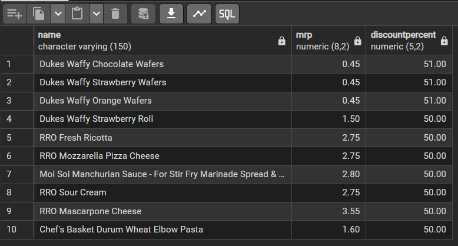
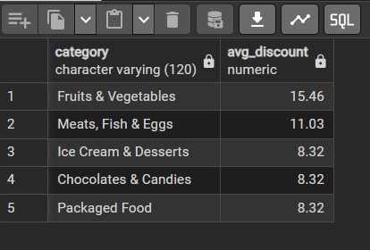

# 🛒 Zepto SQL Analysis

SQL analysis of Zepto's product and inventory data in **PostgreSQL**, covering data exploration, cleaning, and business questions on discounts, pricing, stock availability and estimated revenue.

## 🎯 Objective
To use SQL to clean the product data and answer practical business questions that support decisions on pricing, discounts and inventory planning.

## 🗂️ Dataset
- **Name:** Zepto
- **Size:** 3731 rows × 9 columns
- **Columns:** category, name, MRP, discount percent, available quantity, discounted selling price, weight (grams), out-of-stock status, quantity

## 🛠️ Tools Used
SQL (PostgreSQL), pgAdmin

## 🔄 Project Workflow

### 1. Database Setup
- Created the `zepto` table with a serial primary key (`sku_id`) and 9 data columns, then imported the CSV

### 2. Data Exploration
- Counted total records and previewed sample rows
- Checked every column for **NULL values**
- Listed the distinct product categories
- Compared **in-stock vs out-of-stock** products
- Found product names that appear **multiple times** (several SKUs under one name)

### 3. Data Cleaning
- Found products with an **MRP of zero** (invalid pricing) and **deleted** them
- Converted MRP and selling price from **paise to rupees**

### 4. Business Analysis
1. Which are the **top 10 products by discount percentage**?
2. Which **high-MRP products (above ₹300) are out of stock**?
3. What is the **estimated revenue for each category**? (selling price × available quantity)
4. Which products have an **MRP above ₹500 but a discount below 10%**?
5. Which **top 5 categories offer the highest average discount**?
6. Which products offer the **best price per gram** (items of 100 g and above)?
7. How can products be grouped into **Low, Medium and Bulk** weight categories?
8. What is the **total inventory weight per category**?

Full queries: [`sql/Zepto_Analysis.sql`](sql/Zepto_Analysis.sql)

## 📈 Key Insights
- The deepest discounts reach **51%**, on three **Dukes Waffy wafer** products (chocolate, strawberry and orange), followed by several products at **50%**, including RRO dairy items and Moi Soi sauce
- **Fruits & Vegetables** has the highest average discount at **15.46%**, followed by **Meats, Fish & Eggs** at **11.03%**
- Cooking essentials & Munchies has the  highest estimated revenue, after verifying the figures
- 

## 💡 SQL Concepts Used
`SELECT` · `WHERE` · `GROUP BY` · `HAVING` · `ORDER BY` · `LIMIT` · `DISTINCT` · `CASE WHEN` · `ROUND` · `AVG` · `SUM` · `COUNT` · `UPDATE` · `DELETE`

## 🖼️ Sample Output



## 📁 Repository Structure
```
zepto-sql-analysis/
├── data/      # Dataset (CSV)
├── images/    # Query result screenshots
├── sql/       # SQL queries
└── README.md
```

## 👤 Author
**Sidharth R**
[LinkedIn](https://www.linkedin.com/in/sidharth-r-943115233) · [GitHub](https://github.com/sidharthram99) · ✉️ sidharthram99@gmail.com
